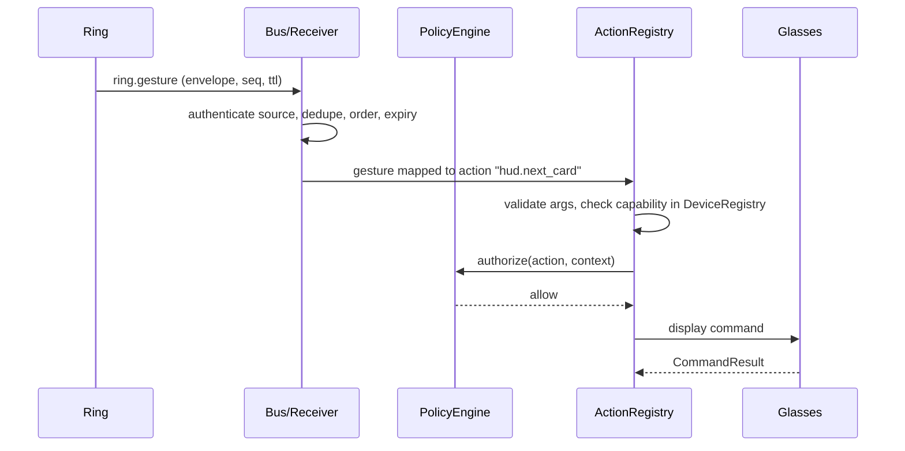
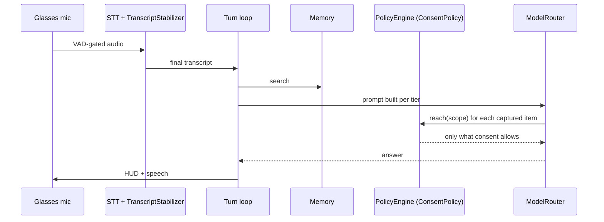
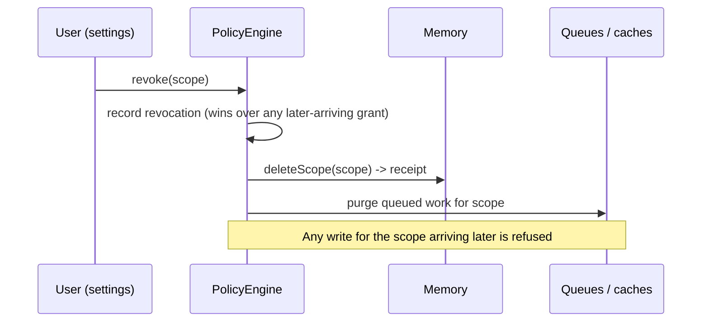
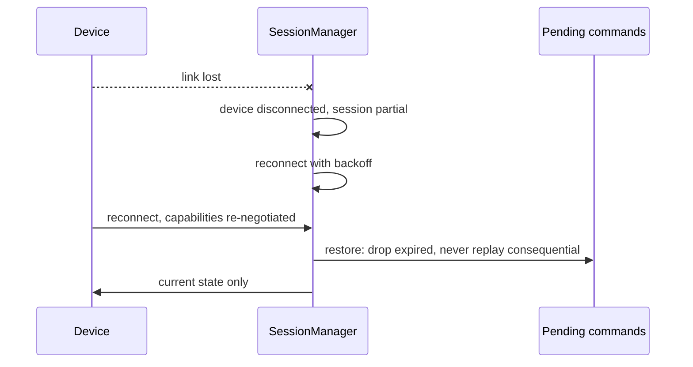

# Personal Context Engine — architecture (ANI-195)

**Status: proposed, awaiting ratification.** This records the service boundaries the code in
`src/pce/`, `src/bus/`, `src/agent/`, `src/pay/`, `src/nav/` and `src/vision/` already implements,
so the remaining tickets (ANI-201, 202, 203, 207, 209–214) build against one contract instead of
inventing their own. Nothing here silently changes ADR-001 to ADR-004; where this document
interprets one of them, the section says so.

## 1. Device roles and state authority

| Device | Owns (is the authority for) | Does not own |
| --- | --- | --- |
| **Ring** | Its sensors, gestures, haptics, battery, wellness samples | What a gesture *means* — that is the phone's action mapping |
| **Glasses** | Camera, microphone, display contents, IMU, speaker, their own battery | Whether a capture is permitted — that is policy, on the phone |
| **Phone** | The shared session, consent ledger, policy, memory, routing, action dispatch | Any device's physical state; it holds a *view* that the device corrects |

The phone is a **coordinator, not a single point of failure** for the devices' own safety
functions. Each device keeps working in a defined degraded mode without it: the glasses stop
capture and clear the HUD on link loss, the ring keeps logging and buffering. No cloud service is
mandatory for any function listed as local in §3.

## 2. Phone-side modules

Each shared module has one owner (the module), one interface (its port), one state authority and
a failure contract. Module names are the ones ANI-195 lists.

| Module | Interface | State it is the authority for | When it fails |
| --- | --- | --- | --- |
| DeviceRegistry | `pce/registry.ts` `DeviceRegistry` | Which devices are paired and what each can do *now* | Unknown capability is `unknown`, never assumed supported |
| DeviceAdapter | per transport, behind `Bus` | Nothing; translates | Link loss is reported to SessionManager as `disconnected` |
| ConnectionManager / SessionManager | `pce/session.ts` `SessionManager` | Device link states, the ecosystem session, the active device per role | Degrades to ring-only / glasses-only / phone-only; never replays expired or consequential commands |
| EventBus | `bus/bus.ts` `Bus`, envelope in `bus/envelope.ts` | Nothing persistent | Bounded queues; safety events never dropped; expired events dropped not delivered late |
| PolicyEngine | `pce/policy.ts` `PolicyEngine` | Consent ledger, confirmations, context gates (quiet hours, driving, meeting, DND) | **Fails closed**: no decision is a deny |
| ActionRegistry | `pce/actions.ts` `ActionRegistry` | The finite set of actions the agent can request | Unknown action or argument is rejected with a typed reason before dispatch |
| ActionDispatcher | ANI-207 (next) | In-flight action state | Timeout is a typed failure, never a retry of a consequential action |
| ModelRouter | `agent/model.ts`, consent via `agent/egress.ts` | Nothing persistent | Falls through tiers; each tier sees only what consent allows |
| MemoryPort | `memory/memory.ts` `MemoryStore` | Memories, revoked scopes | Write-path rules in one `assertWritable`; revocation survives restore |
| ContextEngine, SensorFusion | ANI-200 / ANI-202 (next) | Working and situational context | Stale context expires rather than being used |
| ToolAdapter | ANI-208 (next) | Nothing; wraps phone APIs as registered actions | Missing OS permission is `permission_denied` |
| Telemetry | ANI-211 (next) | Nothing personal: ids, timings, outcomes | Dropped, never blocks a user action |

**Vendor isolation.** No module imports a bus vendor's types. `scripts/check-bus-imports.py`
enforces it in CI (guardrails workflow); only a `*zenoh-adapter*` file may import Zenoh (ADR-001).

## 3. Where things run

| Function | Runs on | Why |
| --- | --- | --- |
| Stop capture, mute, clear HUD, capture LED | **Device**, synchronously | Safety. Never on the bus (ANI-196's last criterion) |
| VAD, pre-roll, button and IMU gestures | Device | Latency, and audio is gated before it leaves |
| Speech recognition (streaming), wake word, timers, the clock | Phone | ADR-004; works offline |
| Policy, consent ledger, memory, action dispatch | Phone | The coordinator's job; works offline |
| Small model tier | Phone/puck (`device`) or site | Latency for the common case |
| Heavy model tier, vision model | Site or cloud, **only where consent reaches** | Capability for the rare case (ANI-25) |
| Navigation routing | Phone (Google Navigation SDK) | The SDK is the route authority (ANI-239) |
| Payment authorisation | PSP / issuer surface on the phone | Never ours (ANI-233) |

## 4. Sequences

Camera capture → vision → answer follows the voice sequence with `vision/product.ts` in place of
the router: the capture's scope must reach the vision model's locality before the image is sent.

## 5. Data ownership, retention and trust boundaries

* **Trust boundaries:** device ↔ phone (authenticated link; envelope source must match the
  authenticated peer), phone ↔ site/cloud (policy-gated egress), phone ↔ PSP/OS (trusted surfaces
  we hand off to and never impersonate).
* **Untrusted inputs:** QR payloads, OCR text, model output, web content, notification text. They
  are data; none of them can choose an action. Actions come from the registry's closed set.
* **Retention:** per-class policy applied at write (`memory/types.ts DEFAULT_RETENTION`), captures
  transient by default, revocation terminal and remembered (`mem:revoked`, and the policy ledger).
* **Versioning:** event payloads by `schemaVersion` with an accepted range per type; actions by
  `version` with explicit deprecation; protocol v0/v1 per `LINK_CONTRACT.md`.

## 6. How this reads the earlier decisions

* **ADR-001 (bus):** kept. The Bus port is publish/subscribe/query; Zenoh only in its adapter.
* **ADR-002 (consent ledger):** kept and extended. Captured data carries a scope on every path —
  memory writes, bus events and model egress. The PolicyEngine is the ledger's runtime view.
* **ADR-003 (on-premise):** kept. `site` locality exists so a plant's own endpoint can see what a
  hosted one cannot.
* **ADR-004 (STT, no voice biometrics):** kept. Speaker identification stays off until ANI-91 and
  ANI-251 are decided; the policy engine has no "speaker" signal to act on.
* **ANI-25:** the egress rules in `agent/egress.ts` are not replaced. The PolicyEngine implements
  their `ConsentPolicy` port, so there is one source of truth for how far a scope may travel.
  Its `device` locality covers the wearable and the phone; ANI-206's "local" and "phone"
  destinations both map to it.

## 7. Open, needing a decision

* Whether the phone may delegate coordination to a puck (ANI-16 / ANI-34).
* ANI-91 and ANI-251, before any speaker-identifying feature.
* Whether self-reported memories need a destination consent too (see ANI-25's comment).
